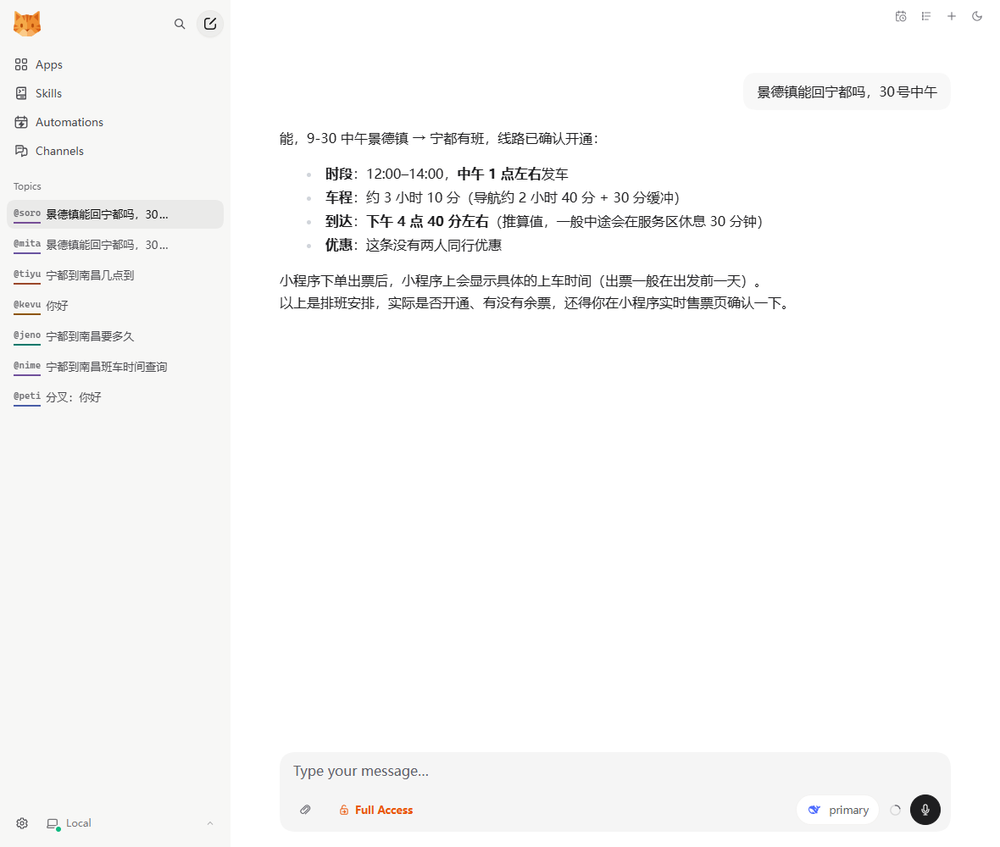
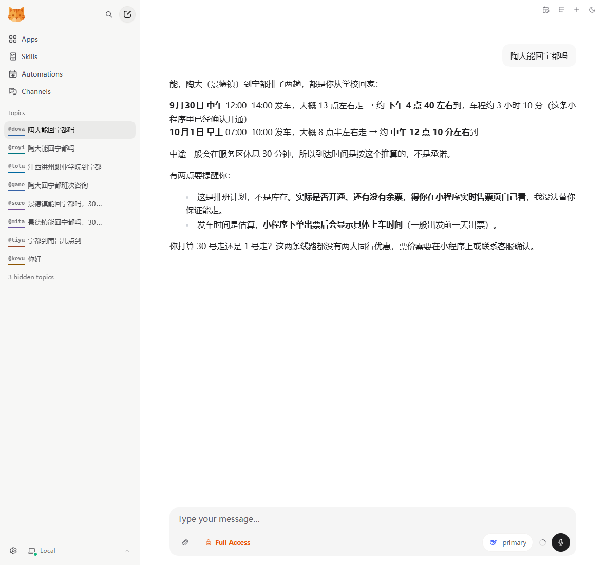
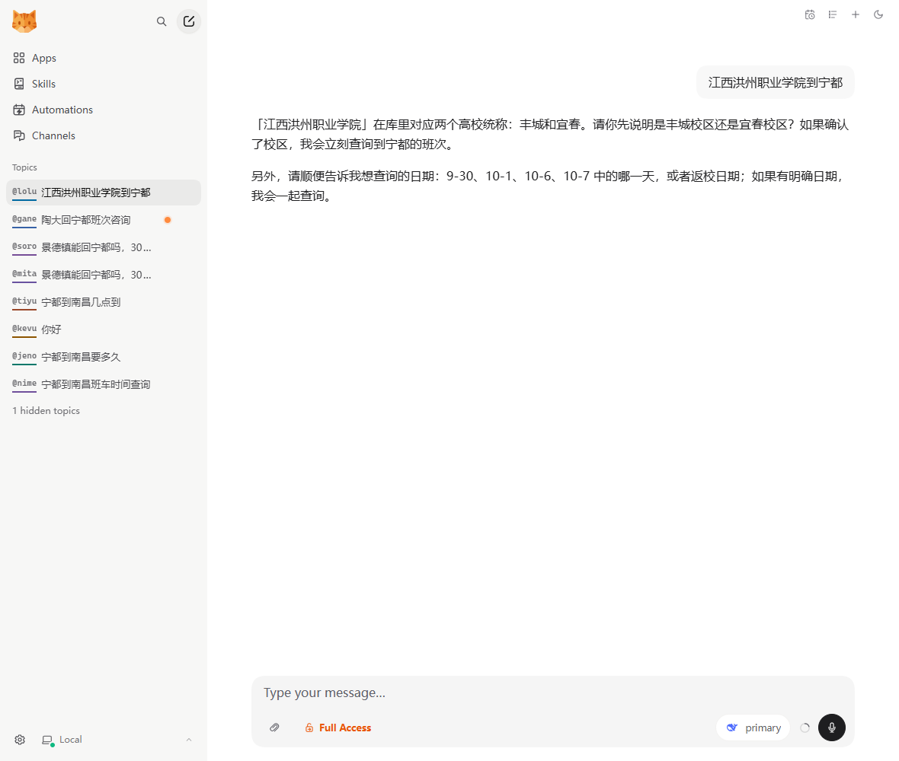

# 江西高校直通车查票 Agent

> 把票务员脑子里的线路表，变成一问就答的 AI 客服。
>
> 覆盖 **15 个高校统称 · 137 条院校别名 · 308 条班次 · 238 条线路车程**



---

## 为什么做这个

节假日返乡高峰，一个票务员每天要回答几十条重复咨询：

> "景德镇能回宁都吗？"　"几点发车？"　"要坐多久？"　"两个人有优惠吗？"

答案全在一张几十行的排班表里。**翻表要时间，答错了要担责**——学生白跑一趟的成本，远比多问一句高。

这个项目的目标很朴素：**让 Agent 记住这张表，并学会在不确定的时候闭嘴。**

---

## 三个关键场景

### 1️⃣ 学生说"陶大"，它知道是景德镇

学生不会说"景德镇陶瓷大学"，只会说"陶大"。



一次问出两条班次、各自的车程与到达时间，还主动追问"你打算 30 号走还是 1 号走"。

**这背后是 137 条院校别名映射**——开发做不出这张表，因为它不在代码里，在业务员的脑子里。

### 2️⃣ 校名有歧义时，它追问而不是猜

「江西洪州职业学院」同时有丰城和宜春两个校区。



**它拒绝回答，先问清校区。** 这是整套系统最重要的设计——宁可多问一句，不要答错一次。

### 3️⃣ 它永远不说"有票"

排班计划 ≠ 实际可售。库里标着班次，小程序上可能早就卖完了。

所以每次回答都带两层声明：

- **余票声明**：「以上是排班安排，实际是否开通、有没有余票，得你在小程序实时售票页确认。」
- **时间声明**：「发车时间是估算，小程序下单出票后会显示具体上车时间（一般出发前一天出票）。」

第二句是关键：**它把"我们只能估算"变成了"下单后就有准时间"**，给学生一个确定的下一步。

---

## 数据规模

| 项目 | 数量 |
|---|---|
| 线路班次 | **308** 条（返乡 152 / 返校 156） |
| 院校别名 | **137** 条（15 个统称 / 100+ 所院校） |
| 线路车程 | **238** 条 |
| 政策问答 | 7 条 |

车程由高德地图路径规划接口预计算落库，运行时零 API 调用。

---

## 四个设计决策

### 1. 放弃向量检索，改用结构化查询

线路表本质是「出发地 × 目的地 × 日期 × 时段 × 方向 × 优惠」的六维矩阵，不是可泛读的文档。

**纯 RAG 会漏行、会编造发车时间、会答错优惠条件。** 所以最终架构是：

```
学生提问 → 口语归一为业务统称 → SQL 精确命中 → 模型只负责组织话术
```

LLM 不碰事实判断，只做「听懂人话」和「说人话」。

### 2. 约束下沉到数据层，不靠提示词自觉

模型会忘事，所以关键约束由脚本直接输出，而不是写在提示词里等它记住：

```json
{
  "notice": "以上为排班安排…禁止承诺有票",
  "rest_notice": "一般中途会在服务区休息 30 分钟",
  "depart_disclaimer": "小程序下单出票后…"
}
```

**写在文档里会被跳过，出现在返回值里躲不掉。**

### 3. 名称有歧义时，脚本拒绝查询

```json
"ambiguity": ["origin=江西洪州职业学院 对应多个统称：丰城、宜春"],
"hints": ["存在名称歧义：先向用户确认，确认前不要给出班次结论"]
```

`found` 直接置为 `false`，从源头杜绝"猜一个"。

### 4. 车程缓存优先，未命中实时补算

| 策略 | 单次耗时 |
|---|---|
| 查本地缓存 | **0.034 毫秒** |
| 实时调接口 | 约 500 毫秒 |

命中就秒回，没命中才联网，算完写回缓存——**越用越全**。同时避免"接口挂了整个系统答不出话"。

### 顺带一个数据治理的小故事

初版车程算出来，所有"共青"相关线路都是 **700–800 分钟**（实际 100–130）。

原因：高德把「共青」匹配到了**贵州省遵义市播州区共青**。

修复方式是加一张地名纠偏表。校验规则也沉淀成了一条 SQL：

```sql
SELECT name, formatted FROM locations WHERE formatted NOT LIKE '%江西省%';
```

**一行就能揪出所有跨省误匹配。**

---

## 技术栈

| 层 | 选型 |
|---|---|
| Agent 运行时 | [nanobot](https://github.com/HKUDS/nanobot)（Skill 插件机制，零源码改动接入） |
| 模型 | DeepSeek |
| 数据 | SQLite（线路 / 别名 / 车程 / FAQ 四表） |
| 地图 | 高德开放平台路径规划 API |
| 语言 | Python 3.13（标准库为主，无第三方依赖） |

**为什么选 Skill 插件而不是改框架源码**：业务逻辑在框架外面，换壳不用重写。框架升级时直接 `git pull`，扩展部分零冲突。

---

## 快速开始

```bash
# 1. 复制到 nanobot 技能目录
#    Windows: %USERPROFILE%\.nanobot\workspace\skills\
#    macOS/Linux: ~/.nanobot/workspace/skills/

# 2. 查询班次
python scripts/query_bus.py --from 陶大 --to 宁都 --date 9-30
```

返回：

```json
{
  "found": true,
  "routes": [{
    "origin": "景德镇", "destination": "宁都",
    "date": "2026-09-30", "period": "中午",
    "depart_estimate": "13:00", "arrival": "16:40"
  }],
  "duration": {"text": "约 3 小时 10 分"},
  "notice": "以上为排班安排，实际余票请在小程序确认"
}
```

### 常用命令

```bash
python scripts/query_bus.py --alias 陶大              # 只解析校名归属
python scripts/query_bus.py --to 宁都 --date 10-1     # 查某县能从哪些学校出发
python scripts/query_bus.py --faq 优惠                # 查政策问答
python scripts/query_bus.py --clusters                # 列出全部高校统称
```

### 数据维护

```bash
python scripts/build_db.py                            # 重建数据库
python scripts/build_geo.py --key 高德Key             # 批量补车程
python scripts/set_duration.py --from 景德镇 --to 宁都 --minutes 160   # 手工录车程（优先于接口）
python scripts/mark_status.py --set confirmed --date 9-30 --yes        # 标记线路已确认可售
```

---

## 目录结构

```
zhi-tong-che/
├── SKILL.md              技能说明（Agent 读取，含 11 条应答规则）
├── README.md             本文档
├── screenshots/          真实对话截图
├── data/bus.db           SQLite 数据库
└── scripts/
    ├── query_bus.py      查询脚本（Agent 主要调用入口）
    ├── build_db.py       数据源 + 建库
    ├── build_geo.py      高德批量算车程
    ├── amap.py           地图接口封装
    ├── set_duration.py   手工录入车程
    └── mark_status.py    标记线路开通状态
```

---

## 已知边界

**数据缺口来自源头，不是实现问题：**

- 174 条线路只知时段（如"早上"）不知具体时刻 → 已按「中间值 + 左右」兜底
- 上车点、退改规则、行李额度 → 暂无数据，Agent 一律回答"请咨询客服"
- 线路是否开通需人工核对小程序 → 支持状态标记，未标记的按"排班计划"表述

**这些只有业务方能补，也正是这套系统需要人机配合的原因。**

---

<p align="center">
  <sub>业务经验是护城河，代码只是把它变成可复用的东西。</sub>
</p>
